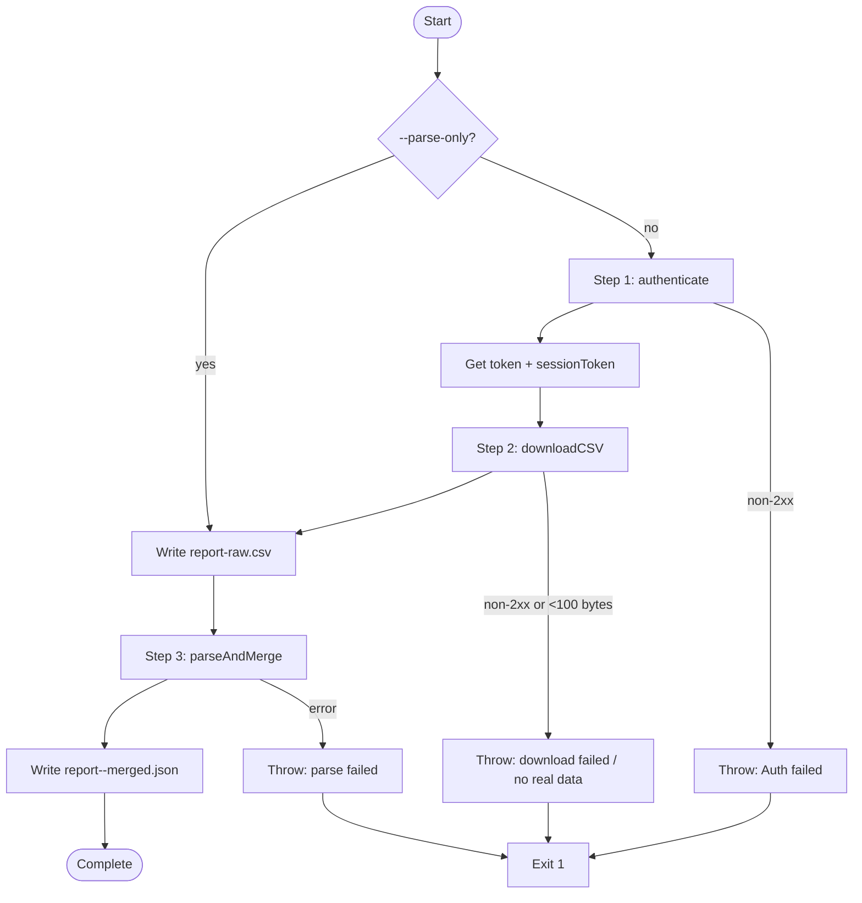
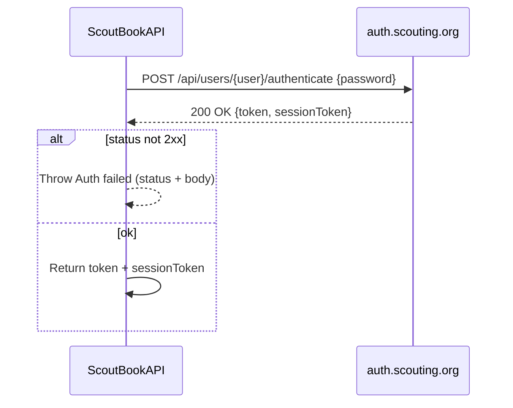
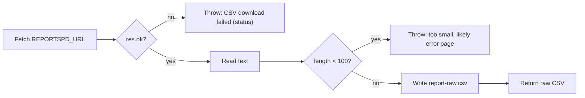
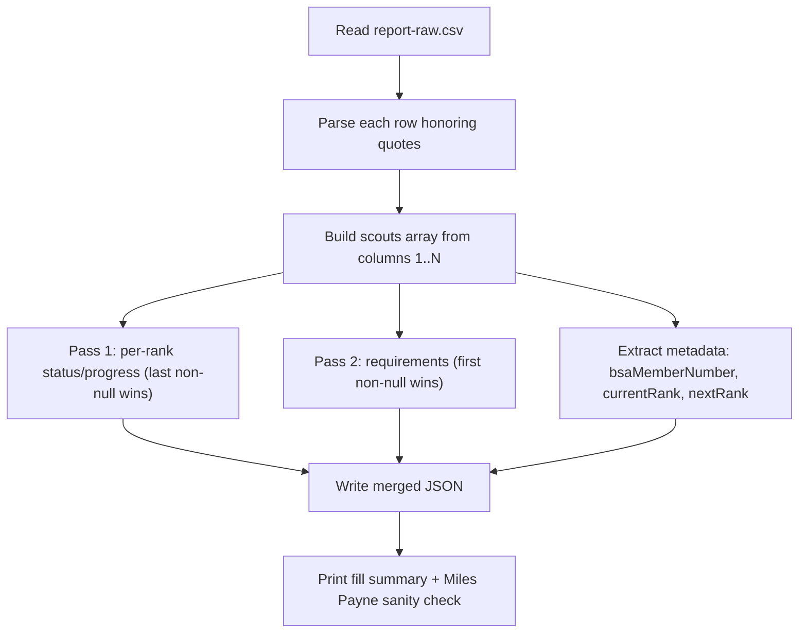
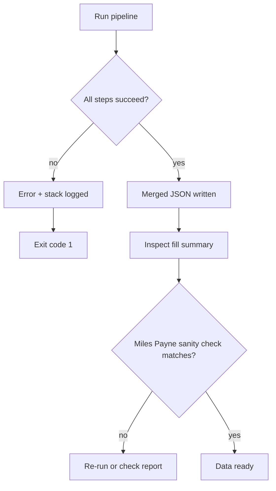

# ScoutBookAPI.js — BSA Scout Report Scraper

▸ ANSWER: `ScoutBookAPI.js` downloads a Boy Scouts of America (BSA) troop advancement report in three steps — authenticate, fetch the raw CSV, and parse/merge it into clean JSON — then writes the structured data to disk.

---

## What This Does

Automates collection of BSA advancement data for a single troop report. It runs, in order:

1. **Authenticate** → `POST` to `auth.scouting.org` to obtain an API token + session token.
2. **Download CSV** → fetch the raw advancement report CSV from `reportspd.scouting.org`.
3. **Parse CSV** → convert the messy raw CSV into a clean, merged JSON structure.

---

## Usage

```bash
node ScoutBookAPI.js             # Full run: authenticate → download → parse CSV
node ScoutBookAPI.js --parse-only # Skip auth/download; re-parse existing report-raw.csv
```

---

## Configuration

Credentials and endpoints come from `config.yaml` (see `config.example.yaml`).

> ⚠️ **Secret safety:** `config.yaml` is git-ignored. Commit `config.example.yaml` instead so secrets never reach the repo.

The only hard-coded dynamic value is `REPORT_ID = '2185931'`, embedded in `REPORTSPD_URL` and echoed into the merged-JSON output (`reportId` + output filename). Change it to pull a different troop report.

---

## Pipeline Overview



---

## Step 1 — Authenticate

`authenticate()` POSTs to `https://auth.scouting.org/api/users/{user}/authenticate` with the `config.yaml` password and returns `{ token, sessionToken }`.



- Content-Type: `application/json`, Accept: `application/json; version=2`.
- Returns are truncated to 12 chars in logs (full values stay in memory).

---

## Step 2 — Download CSV

`downloadCSV(sessionToken)` fetches `REPORTSPD_URL`, requiring only the `SessionToken` cookie.



- `redirect: 'follow'` is set.
- The `<100 byte` guard catches error pages masquerading as data.

---

## Step 3 — Parse CSV → Merged JSON

`parseAndMerge()` restructures the raw CSV. The CSV is a matrix: **column 0 = row labels** (rank sections, requirement numbers, metadata); **each subsequent column = one scout**.



### Key parsing logic

| Function | Purpose |
|---|---|
| `parseCSVLine` | Splits a row into fields, honoring double-quoted cells, escaped `""`, and commas inside quotes |
| `detectRankSection` | Maps a row label to a normalized rank key (Scout → Eagle); matches `v####` variants |
| `parseReqNumber` | Extracts a requirement number from labels like `Req #1` |
| `parseStatus` | Normalizes a cell into `{status, progress}`; strips HTML anchors |

**Rank key map:** `scout`, `tenderfoot`, `secondClass`, `firstClass`, `star`, `life`, `eagle`.

**Rules baked in:**
- Status: empty → both null; value ending in `%` → progress only; otherwise status only.
- Requirements: first non-null value wins across versioned rows; HTML fragments (e.g. `</a>` for unearned items) are stripped, leaving `null` when empty.
- Metadata rows (`bsa member #`, `current rank`, `next rank`) are read from column 0 per scout column.

---

## Outputs

| File | Description |
|---|---|
| `report-raw.csv` | Raw CSV verbatim from `reportspd.scouting.org` |
| `report-2185931-merged.json` | Clean, structured advancement data (main deliverable) |
| `logs/scraper.log` | Append-only log of every run (stdout is also mirrored) |

Merged-JSON shape:

```json
{
  "reportId": "2185931",
  "source": "https://reportspd.scouting.org",
  "generatedAt": "2024-01-01T00:00:00.000Z",
  "scoutCount": 0,
  "scouts": [
    {
      "name": "",
      "bsaMemberNumber": null,
      "currentRank": null,
      "nextRank": null,
      "ranks": { "scout": { "status": null, "progress": null, "requirements": {} }, ... }
    }
  ]
}
```

---

## Exports (for `require()` / tests)

```js
const { authenticate, downloadCSV, parseAndMerge, log, cfg } = require('./ScoutBookAPI.js');
```

`cfg` is exported for convenience in testing.

---

## Failures & Exit Codes

- Any pipeline failure prints the error + stack and exits with code `1`.
- Config load is **fail-fast**: a missing/malformed `config.yaml` throws at startup, not at the first auth call deep in the pipeline.

---

## Dependencies

- `js-yaml` — parse `config.yaml`.
- Node built-ins: `fs`, `path`, `fetch` (Node 18+).

---

## Known Gotchas

- **CSV cells contain HTML.** `</a>` marks unearned items; all tags are stripped before values are stored.
- **Versioned rank labels** like `First Class v2024` are handled by `detectRankSection` regex.
- **`report-raw.csv` must exist** for `--parse-only` mode; it is created by a prior full run.
- **One report per run.** `REPORT_ID` is hard-coded; change it to target a different troop.

---

## Validation Flow


