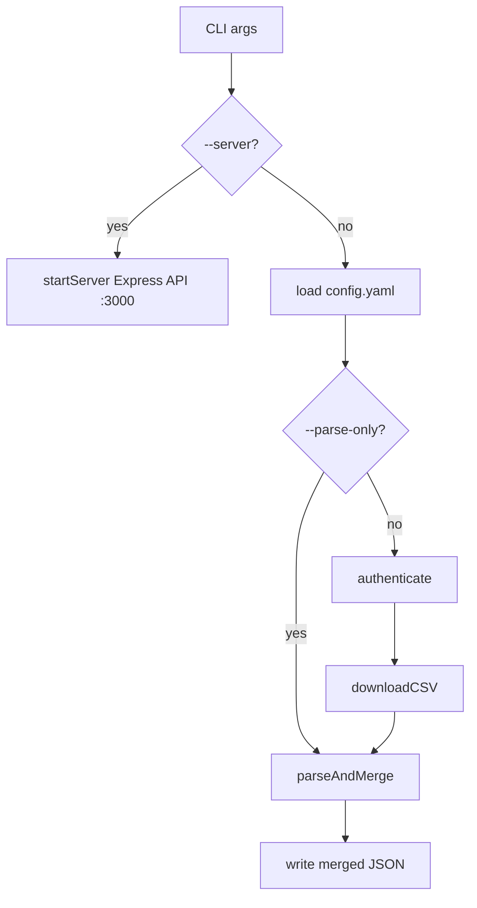
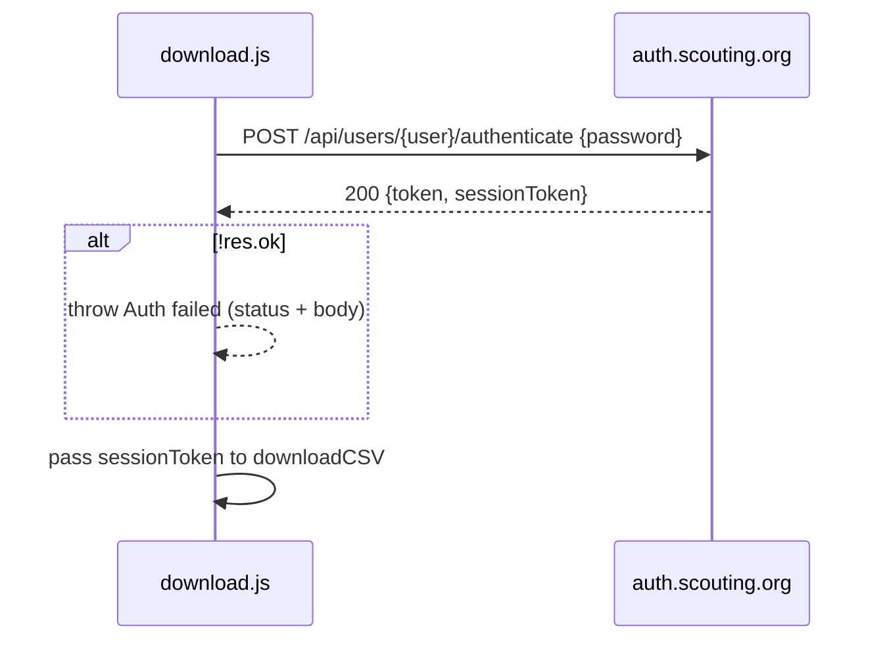
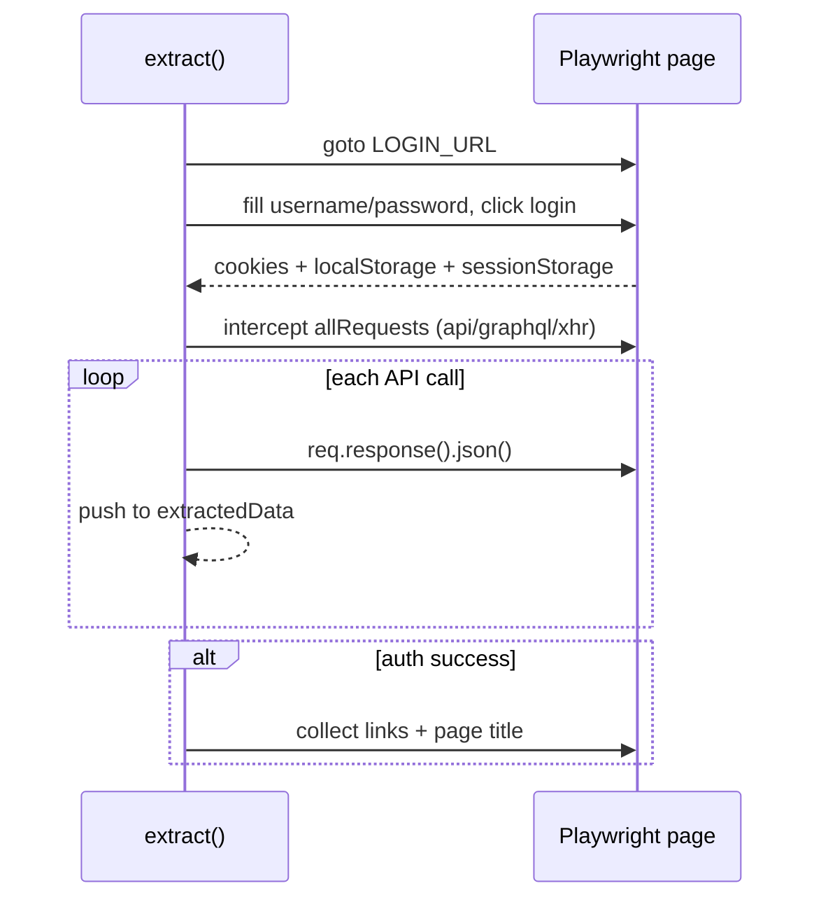

# 📥 download.js — Scout Report Download Pipeline

## What This Is

A Node.js script that pulls BSA advancement data from `reportspd.scouting.org`, parses the CSV into structured JSON, and optionally runs an Express scraping API. It reads config from `config.yaml`.

## Architecture



## The Three Steps

| Step | Function | I/O |
|---|---|---|
| 1 — Auth | `authenticate()` | `POST auth.scouting.org/api/users/{user}/authenticate` → token + sessionToken |
| 2 — Download | `downloadCSV(sessionToken)` | `GET reportspd.scouting.org` with `SessionToken` cookie → `report-raw.csv` |
| 3 — Parse | `parseAndMerge()` | `report-raw.csv` → `report-2185931-merged.json` |

## Auth Flow



Auth uses the Scoutbook API. Only the `SessionToken` cookie is needed for the CSV download (verified via curl).

## CSV → JSON Transformation

The CSV is a transposed grid: scouts are **columns**, rank fields are **rows**. Parser walks column-by-column.

```mermaid
flowchart LR
  subgraph IN[report-raw.csv]
    R0[Row 0 = scout names]
    R1[Row N = rank labels]
  end
  subgraph PROC[parseAndMerge]
    P1[detectRankSection → rank key]
    P2[parseReqNumber → req ID]
    P3[parseStatus → status/progress]
    P4[strip HTML tags from cells]
  end
  subgraph OUT[merged.json]
    J[{name, currentRank, ranks:{...requirements}}]
  end
  R0 --> P1
  R1 --> P1
  R1 --> P2
  P1 --> P3
  P3 --> P4
  P4 --> J
```

### Rank Key Mapping

`scout, tenderfoot, secondClass, firstClass, star, life, eagle` — detected via exact match or `^<rank> v\d{4}$`.

## Scraper Engine (browser.js + custom-extraction.js)

`launchBrowser()` and `scrape()` are provided but **not called** by the default CLI path. They launch a persistent Playwright Chromium context and support three extraction strategies.

```mermaid
flowchart TD
  POST["POST /scrape {targetUrl, extractionStrategy}"]
  POST --> CHECK{valid strategy?}
  CHECK -->|no| E400["400 valid: network-intercept | accessibility-tree | custom"]
  CHECK -->|yes| STRAT{strategy}
  STRAT -->|network-intercept| F1[return 200-status requests]
  STRAT -->|accessibility-tree| F2[return page.accessibility.snapshot()]
  STRAT -->|custom| F3[extract() full login + intercept]
  F1 --> SC[scrape() launchBrowser → goto → extract → write files]
  F2 --> SC
  F3 --> SC
```

`scrape()` writes `data.json`, `logs/network_log.json`, `logs/cookies_diff.json`, `logs/ls_diff.json`. On error it dumps `logs/error_dom.html` + `logs/error_dump.json` and **rethrows — no fallback**.

### Custom `extract()` Strategy

Logs into `advancements.scouting.org/login`, captures cookies/localStorage/sessionStorage, intercepts `/api/` + graphql calls, and pulls post-auth links + page title.



## Asset & Proxy Helpers

| Function | Purpose |
|---|---|
| `downloadAsset(page, url, filename)` | Fetches an image via Playwright, saves to `images/`, returns `./images/{filename}` |
| `decodeProxyUrl(url)` | Decodes proxy redirect patterns (`external-content`, `link.`, `redirect/`) |
| `findAccessibleElement(page, role, name)` | Depth-searches the accessibility tree for a node |

## CLI Usage

```bash
node download.js              # full: auth → download → parse
node download.js --parse-only # re-parse existing report-raw.csv
node download.js --server     # start Express API on :3000
```

Endpoints: `POST /scrape` (extraction), `GET /health` → `{status: ok}`.

## Config & Outputs

```
config.yaml          # cfg.scoutbook.user / .password
report-raw.csv       # raw CSV from reportspd (Step 2 output)
report-2185931-merged.json  # final structured data (Step 3 output)
logs/scraper.log     # append-only log
images/              # downloaded assets
CHROME_PROFILE/      # persistent Playwright profile
```

`REPORT_ID = '2185931'` is hardcoded in the URL.

## Failure Modes

- **Auth fails** → throws with status + body, pipeline exits 1
- **CSV too small (<100 bytes)** → treated as not-real-data, throws
- **Extraction error** → dumps DOM + stack to logs, rethrows (no fallback)
- **Invalid strategy** → 400 with valid list

## Exports

`authenticate, downloadCSV, parseAndMerge, scrape, extract, launchBrowser, downloadAsset, decodeProxyUrl, findAccessibleElement, log, cfg` are all `module.exports`d for `require()` usage.
